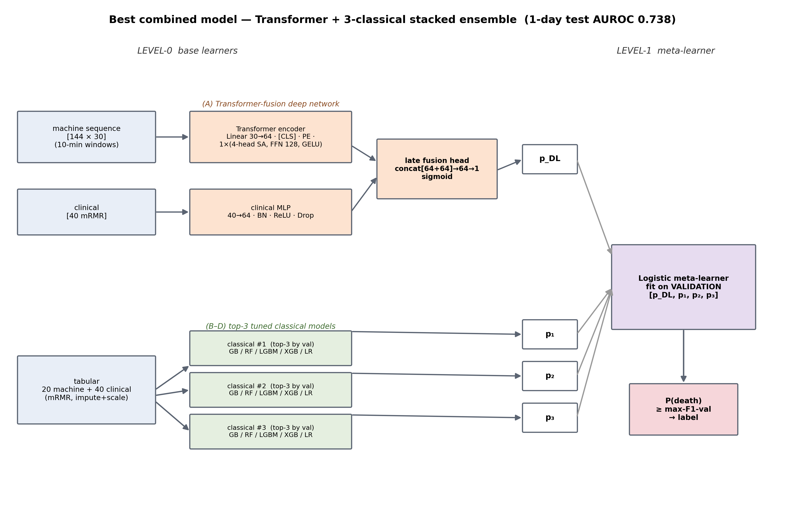

# CRRT Rolling-Based Mortality Prediction

Code for the paper

> **Rolling Day-Wise Mortality Prediction in Critically Ill Patients With AKI on CRRT Utilizing Machine Pressure Waveforms**
> Shehan Irteza Pranto, Joanna Yang, Joshua Lambert, Stuart L. Goldstein, Lili Chan, Girish N. Nadkarni, Tiago K. Colicchio, Javier A. Neyra, Jin Chen.
> *IEEE International Conference on Big Data (IEEE BigData), 2026.*

The study asks whether the minute-level circuit pressures recorded by a continuous renal replacement therapy (CRRT)
machine (access, filter, effluent and return pressure, plus derived trans-membrane pressure, pressure-drop and
access-return difference) carry prognostic information about short-horizon mortality beyond the electronic health
record. For every CRRT day *t* the models predict death on day *t+2* from the data available up to the end of day *t*,
and the prediction is refreshed daily ("rolling").

The final model is a **Windowed-Transformer Fusion Stack**: a transformer encoder over 10-minute windows of the
cleaned pressure signals, fused with a clinical MLP branch, stacked with classical learners through a logistic-regression
meta-learner on a grouped-mRMR budget of 40 machine and 60 clinical features.



## What is in this repository

```
.
├── Code/                              stage 0 notebooks: signal alignment, priming/downtime removal, peak cleaning, labels
│   ├── Denoising/                     CRRT_stream_denoising.ipynb (+ downtime-threshold ablation variant)
│   ├── label_processing/              rolling 1-day / 2-day / 7-day labels
│   └── baseline_model/                early per-day feature tables (historical, not used by the paper's final models)
├── Baseline_ML_Models_v2/
│   ├── Deep_Learning_Models/          encoder definitions (CNN1D, BiGRU, Transformer, MLP, fusion) and the metric protocol
│   ├── Machine_Clinical_Models/       classical hyper-parameter grids and preprocessing utilities
│   ├── Clinical_Only_Models/          notebook that builds the clinical (lab + demographic/comorbidity) tables
│   └── abalation_study_v2/            everything in the paper's Results section
│       ├── preprocessing/             patient-level splits, 133 base machine features, sequence cache, clinical table
│       ├── models/, eval/             grouped mRMR, classical learners, resampled evaluation protocol
│       ├── exp_2/                     fixed-budget classical benchmark (Table IV), base SHAP
│       ├── exp_3/                     200-feature enrichment, attention-CNN, CNN-fusion stack
│       ├── exp_4/                     Windowed-Transformer Fusion Stack, Tables III, V (rows 5-8), VI, Figs 5-7, bootstrap CIs
│       ├── exp_5_ablation/            preprocessing ladder (Table V rows 1-4)
│       └── paper_materials/           cohort table and signal-pipeline statistics scripts, process notes
├── Data/                              EMPTY skeleton: put the input files here (see docs/DATA_PROCESSING.md)
├── figures/                           the paper's figure sources (architecture, pipeline attrition, budget sweep, loss curves, SHAP)
├── environment/pip_freeze_crrt.txt    exact package versions used for the paper
├── docs/
│   ├── DATA_PROCESSING.md             input files, their schemas, and how the processing stages turn them into model inputs
│   └── REPRODUCTION.md                paper item -> script -> output map, and the end-to-end run order
├── requirements.txt / environment.yml
├── CITATION.cff / LICENSE
```

**No patient data, labels, trained models, result tables or patient-level predictions are included.** Every table in the paper is regenerated by the scripts listed in `docs/REPRODUCTION.md`. The cohort comes from a
multi-centre CRRT registry under data-use agreements; see *Data access* below.

## Quick start

```bash
git clone https://github.com/Shehan-Irteza-Pranto/CRRT-Rolling-based-Mortality-Prediction.git
cd CRRT-Rolling-based-Mortality-Prediction
conda env create -f environment.yml && conda activate crrt      # or: pip install -r requirements.txt
```

1. Place the input files described in [docs/DATA_PROCESSING.md](docs/DATA_PROCESSING.md) under `Data/`.
2. Run the stage-0 notebooks once (signal cleaning, labels, clinical tables).
3. Run the experiments in the order given in [docs/REPRODUCTION.md](docs/REPRODUCTION.md). The one-command
   wrapper `Baseline_ML_Models_v2/abalation_study_v2/run_all.sh` covers the base benchmark; the paper's final tables and
   figures come from the `exp_4` scripts listed there.

All scripts resolve their paths from their own location, so the repository must keep this layout and be run from
within it (`Data/` next to `Code/` and `Baseline_ML_Models_v2/`).

### Hardware used

Two NVIDIA RTX 6000 Ada (48 GB) GPUs. Deep-learning jobs were run one at a time; classical tuning used
`ABL_NJOBS=4` worker processes. A full reproduction of the deep-learning benchmark takes several hours; the classical
benchmark and all table/figure scripts run in minutes once the feature tables exist.

## Headline result

On held-out test patients (1-day-gap horizon) the Windowed-Transformer Fusion Stack with 40 machine and 60 clinical
features reached a test AUROC of 0.766 (patient-clustered bootstrap 95% CI 0.705 to 0.825), against 0.738 for the best
EHR-only stack and 0.625 for the machine-only ensemble. The scripts that produce these numbers, the mRMR budget sweep,
the preprocessing and encoder ablations, SHAP rankings and loss curves are mapped in `docs/REPRODUCTION.md`.

## Data access

The CRRT machine logs and the linked EHR variables cannot be redistributed. Researchers who obtain equivalent data
(a per-minute Prismaflex-style pressure export with patient identifiers and CRRT start/stop times, daily laboratory
values, and admission demographics/comorbidities) can run the pipeline unchanged by matching the schemas in
[docs/DATA_PROCESSING.md](docs/DATA_PROCESSING.md). Requests regarding the original cohort should be addressed to the
corresponding author of the paper.

## Not included in this release

- The synthetic spike-injection benchmark used for the peak-detection parameter choice (Sec. IV-A, Fig. 4); only the
  resulting figure is provided.
- The vendor-specific extraction that turns raw device exports into `Data/Intermediate/extracted_raw.csv`.
- The patient split file; it is regenerated deterministically by `preprocessing/build_splits.py` (fixed seed).
- External-validation and sub-population analyses that are not part of the paper.

## Citation

```bibtex
@inproceedings{pranto2026rolling,
  title     = {Rolling Day-Wise Mortality Prediction in Critically Ill Patients With AKI on CRRT Utilizing Machine Pressure Waveforms},
  author    = {Pranto, Shehan Irteza and Yang, Joanna and Lambert, Joshua and Goldstein, Stuart L. and Chan, Lili and Nadkarni, Girish N. and Colicchio, Tiago K. and Neyra, Javier A. and Chen, Jin},
  booktitle = {Proceedings of the IEEE International Conference on Big Data (IEEE BigData)},
  year      = {2026}
}
```

## License

Released under the MIT License (see `LICENSE`). The license covers the code only; it grants no rights to any data.
